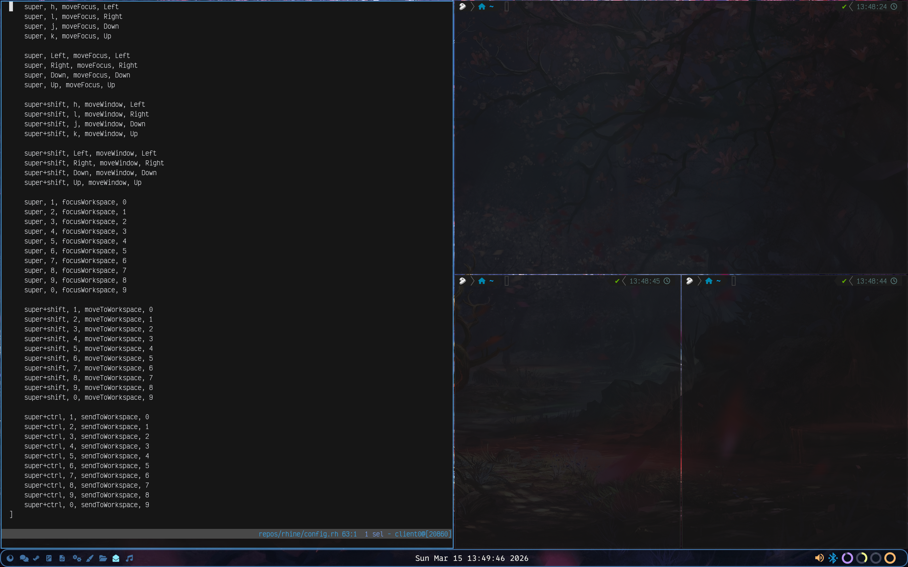

= Rhine: a modular window manager for river
:table-caption!:

Rhine is a window manager for the river wayland compositor (using the river-window-manager-v1 protocol).
The aim is to allow for a modular system of tiling algorithms (maybe even ones loaded from shared object files).
Rhine is meant to be both capable and hackable.



Rhine supports significant parts of the Hyprland IPC protocol (socket 1 and 2) in order to enable external bars.
This works by spoofing the `HYPRLAND_INSTANCE_SIGNATURE` environment variable. This spoofing will only affect processes spawned by Rhine.
Bars I've tested:

- https://github.com/scorpion-26/gBar[gBar]
- https://github.com/alexays/waybar[waybar]
- https://git.haschu.me/haschu/foobar[foobar]

all of which more or less work.
If you encounter any problems, then I'd encourage you to open an issue report.

== config

There is an example link:rhine/src/branch/main/config.rh[config.rh] at the root of this repo.

- The config is loaded from `~/.config/river/config.rh` ( or `XDG_CONFIG_HOME/river/config.rh`).
- The config is reloaded whenever it is changed.
- The config may contain more options than what is specified below. (this allows for example for https://codeberg.org/Sivecano/channel[channel] to share the same config file).

=== input devices & output layout

Rhine will *not* configure your input devices or outputs (monitors).

* input config is what https://codeberg.org/Sivecano/channel[channel] is for
* monitor config can be done with a number of tools like https://sr.ht/~emersion/wlr-randr[wlr-randr] or https://gitlab.freedesktop.org/emersion/kanshi[kanshi]

=== layouts

elements of the `layout` block have the form of `<Workspace ID> <layout>`.
`<workspace ID>` is an Integer or the wildcard `*` and `<layout>` on of the following:

[cols="m,a", frame=none, grid=none]
|===
| Layout | Description

| bsp
| A fairly standard binary space partitioning layout.

|===

=== environment

elements of the `env` block are of the form `<ENV VARIABLE> <value>`.
This sets environment variables for all children of rhine.

=== keybinds

keybinds are of the form `<modifiers>, <key>, <command>`. The same keybinds are currently registered for each seat.

    * `<modifiers>` is a `+`-separated list of the modifiers `super`, `shift`, `alt`, `ctrl` and `none`.
    * `<key>` is the name of a key as found in the `xkbcommon/xkbcommon-keysyms.h` header (with the `XKB_KEY_` part removed).
    * `<command>` is a command

=== pointer bindings

In the `pointer_binds` list pointer bindings are specified.
they are of the form `<modifiers>, <button>, <command>`

* `<modifiers>` is a `+`-separated list of the modifiers `super`, `shift`, `alt`, `ctrl` and `none`.
* `<button>` is the name of the mouse butto. one of `Left`,`Right`,`Middle`,`Side`,`Extra`,`Forward`,`Back` or `Task`.
* `<command>` is a command


=== Commands

Commands are the basic user actions available in `rhine`.
They appear in the config file and in the IPC.

==== Specifiers
different command arguments are specified in different ways:
[cols="m,a,a"]
|===
|Descriptor | Meaning | Options

| <window>
| Specify a window
| the focused window can be selected as `Focus`

| <workspace>
| Specify a workspace
| this is either given by a signed 32-bit integer referring to the ID of the workspace, `Previous`/`Next` to refer
to the workspace with highest/lowest ID which is lower/higher than that of the currently focused workpspace or
`PrevActive` to refer to the workspace last previously shown on the currently focues workspace.

| <toggle command>
| Specify how to change a binary state, this can refer to things like fullscreen or floating status
| one of `enable`, `disable` or `toggle`

| <dir>
| A direction (usually relative to the focused window)
| one of `Left`, `Right`, `Up` or `Down`

|===

==== Command

[cols="m,a", frame=none, grid=none]
|===
| Command | Description

| close, <window>
| close window <window>

| kill, <window>
| send SIGTERM to the process owning window <window> politely asking the process to die

| murder, Focus
| send SIGKILL to the process owning window <window>, killing it

| launch, <shell command>
| launch the command `<shell command>` using `sh -c`

| fullscreen, <toggle>, <window>
| change fullscreen state window `<window>`

| floating, <toggle>, <window>
| change floating state window `<window>`

| overlay, <toggle>, <workspace>
| toggle `<workspace>` as overlay workspace.

| focusWorkspace, <workspace>
| focus the workspace `<workspace>`.

| sendToWorkspace, <workspace>
| send focused window to workspace `<workspace>`.

| moveToWorkspace, <workspace>
| equivalent to `sendTo <workspace>` followed by `focusWorkspace <workspace>`.

| moveFocus, <dir>
| move the seat's focus up, down, left, or right.

| moveWindow, <dir>
| move the focused window up, down, left, or right. floating windows will be moved by 25 pixels.

| layoutCommand, <layout>, <command> [, args]
| run the layout-specific command <command> of layout <layout> with given arguments.
Does nothing on a mismatching layout

| pointerOp, <pointer operation>
| start the specfied pointer operation.

| exit
| Quit River
|===

==== Pointer Operations

A pointer operation is one of the following:

[cols="m,a"]
|===
| Pointer Oepration | Description

| move
| interactively move the focused window

| resize
| interactively resize focused window

| xkill
| close the window under the cursor once the button is released
|===

==== Layout-specific commands
===== bsp
[cols="m,a", frame=none, grid=none]
|===
| Command | Description

| changeSplit
| change the split direction of the split in the binary tree the focused window is part of.
|===

=== windowrules

elements of the `windowrules` block are of the form `<appid>, <rule>`. Where `[appid]` must match a window's appid exactly. The following rules are available:

[cols="m,a", frame=none, grid=none]
|===
| Option | Description

| float
| make the window floating.

| workspace <workspace ID>
| send the window to workspace `<workspace ID>`.
|===

window rules are only applied to new windows.

=== animations

Animations are configured under the `animations` group, the `animations` group contains subgroups for each animations type. these are:


[cols="m,a", frame=none, grid=none]
|===
| Animation Type | Description

| move
| animation for moving windows

| resize
| animation for resizing windows

| workspace
| animation for switching workspaces

|===

each one of these groups then has the same parameters. Namely:

[cols="m,a", frame=none, grid=none]
|===
| duration <MICROSECONDS>
| The duration of this animation in microseconds. Setting this to 0 disables this animation.
| easing{nbsp}<FUNCTION>{nbsp}[,{nbsp}PARAMETERS..]
| The easing function to use as well as some optional parameters. These are the same ones as available in https://codeberg.org/Games-by-Mason/mr_tween[this library] using the same function names, the same named parameters and the same default values for the named parameters.
|===

Putting it all together might look something like this
```
animations {
    move {
        duration 250_000
        easing elasticOut, amplitude=0.2
    }
    resize {
        duration 250_000
        easing elasticOut, amplitude=0.2
    }
    workspace {
        duration 500_000
        easing elasticOut, amplitude=0.2
    }
}
```


.Examples
[cols="a,a", frame=none, grid=none]
|===
| elasticOut
| sinOut
| video::rhine/raw/branch/main/assets/elastic.mp4[opts="autoplay"]
| video::rhine/raw/branch/main/assets/sin.mp4[opts="autoplay"]
|===

=== Window Management options
These go in a top-level block called `window_management`

[cols="m,a", frame=none, grid=none]
|===
| Option | Description

| follow_cursor <bool>
| whether the cursor follow the focus when we change the focused window

| float_move <float>
| the amount by which (relative to the size of the output it's on) a `moveWindow` command moves a floating window.

| border <Border block>
| configure the border width and colour etc.

|===

==== Border
Border contains two keys: `width` and `colours`

[cols="m,a", frame=none, grid=none]
|===
| Option | Description

| width <integer>
| width of the window borders in pixels, defaults to 2

| colours <colour block>
| specify colour for different border types

|===

The following keys are available in the `colours` block.

[cols="m,a", frame=none, grid=none]
|===
| Option | Description

| focus <Colour>
| border colour for focused windows, defaults to `blue`

| inactive
| border colour for non-focused windows, defaults to `gray`

|===

==== Colours

a `<Colour>` parameter can be one of the following:

[cols="m,a", frame=none, grid=none]
|===
| Option | Description

| <integer>, <integer>, <integer>
| an rgb value with a 32-bit unsigned integer for each channel

| <integer>, <integer>, <integer>, <integer>
| an rgba value with a 32-bit unsigned integer for each channel

| blue
| the colour `#4793cc`

| gray
| the colour `#202020`

| hsl, <float>, <float>, <float>
| a colour specified as HSL, where the first parameter is between 0 and 2pi and the others between 0 and 1

| hsla, <float>, <float>, <float>, <float>
| same as `hsl` but with and alpha parameter between 0 and 1

| rgb8, <integer>, <integer>, <integer>
| an rgb value with an 8-bit unsigned integer for each channel

| rgba8, <integer>, <integer>, <integer>, <integer>
| an rgba value with an 8-bit unsigned integer for each channel

|===


== IPC

`rhine` supports _some_ of https://wiki.hypr.land/Configuring/Using-hyprctl/[Hyprland's IPC] mechanism.
The table below lists the available request and their differences.

[cols="a,a"]
|===
| request | description

| `dispatch`
| only `workspace` is available
| `workspaces` 
| contains less information
| `monitors`
| contains less information
| `clients`
| contains less information
|===

Rhine also adds the following _new_ commands to the interface.

[cols="a,a"]
|===
| request | description
| `rhine`
| run a `rhine` command from the table above
|===

== non-goals

What will rhine _not_ do (for now):

* ssd. all windows will be (for now) undecorated (aside from fun borders)
* present the best floating/stacking experience


== running rhine

1. have a `river` version `>=0.4.0` installed
2. install `rhine`
3. run `river` with `rhine` by doing one of the following:
    ** run `river -c rhine`
    ** put `exec rhine` in your river init file
    ** use the provided `rhine.desktop` file as your wayland session

== Missing a Feature?

Rhine is not yet entirely complete but I use it every day.
If you find anything missing, then ask on the https://web.libera.chat/?channels=#river[river irc] or open an issue.

== Dependencies

Rhine is written in the zig programming language.
Rhine currently requires `zig-0.16.0` but at least until 1.0 rhine will
strive to always track the most recent version.

=== protocols bound
rhine binds the following protocols:

* river-window-management-v1
* river-layer-shell-v1
* river-xkb-bindings-v1

=== shared libraries
rhine links the following shared libraries:

* libwayland-client
* libc

optionally rhine also links the following:

* libnotify

=== static libraries
rhine uses the zig build system to statically depend on https://codeberg.org/Sivecano/libtributary[tributary]
a small helper library that facilitates code sharing between rhine and channel.


=== other dependencies

* rhine depends on a header from libxkbcommon

== Installing

. Get rhine's source code by either downloading a release or cloning the git repo.
. Compile rhine by running `zig build` from the project folder. there are however additional options:
    .. `-Dnotify=false` build rhine without libnotify support, this avoids a bunch of dependencies but doesn't send
    notifications
    .. `-Dstrip=true` will instruct the build system to strip debug information from the binary. If you already have infrastructure for things like that in place, it may do a better job.
. you will find the output files in the `zig-out`.
    .. There's a `rhine` binary and a `rhine.desktop` wayland session file for easy use.
    .. if you're packaging rhine then the `zig-out` directory is more or less your build output directory.
    .. if you're not packaging `rhine` you may consider something like moving the contents of `zig-out` to `/usr/local/`


== Strict No LLM / No AI Policy

Use of generative AI/LLMs is strictly forbidden for all contributions to rhine.

This includes bug reports and comments on the issue tracker.

This is the same policy as https://codeberg.org/river/river#strict-no-llm-no-ai-policy[river].

== Contributing
The following list should make it easier to contribute to rhine, if one so wishes to do so:

* I reserve the right to make architectural decisions, please ask before you make a huge PR
* In general, I'd prefer if to have a draft PR opened even when you haven't started yet
* Contributions are most welcome in the following parts:
    ** src/commands.zig for adding more commands
    ** adding more tiler layouts (they are specified in srd/layouts.zig)
    ** adding more pointer operations (found in src/pointer_ops.zig)
* to figure out my longer-term ambitions, check TODO.asciidoc
